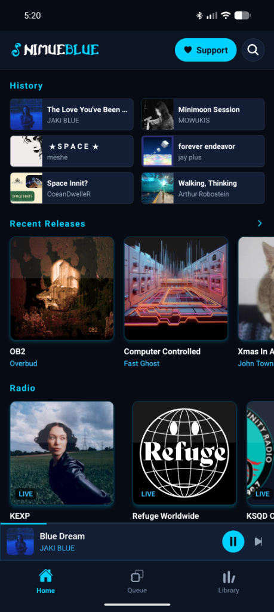

# NimueBlue

An independent audio player for Mirlo, Faircamp catalogs, Funkwhale pods, community radio, podcasts, and your own files.



## Features

- **Independent Music:** Streams releases from [Mirlo](https://mirlo.space) (and Canimus Chorus), verified self-hosted [Faircamp](https://simonrepp.com/faircamp/) catalogs discovered through the [Fairplayer hub](https://fairplayer.band/hub/), and federated [Funkwhale](https://joinfediverse.wiki/Funkwhale) pods (via [Open.audio](https://open.audio/)).
- **Global Community Radio:** Live unrestricted discovery from [Radio-Browser](https://www.radio-browser.info/), plus optional client-side custom stations and filters.
- **Podcasts & Discussions:** Open federated discovery from the [Castopod Index](https://index.castopod.org/) alongside custom client-side RSS feeds, played directly from publisher RSS enclosures.
- **Direct Artist & Station Support:** Support and Donate actions link straight to the artist's release or channel page (on Mirlo, their own Faircamp site, or their Funkwhale pod) or the station's donation page.
- **Offline & Local Library:** Downloads saved as standard tagged audio files, local file import, device-side likes and wishlist support for federated catalogs, optional client-side curation preset (`nimue-curation-preset.json`) / `nimue-library.json` manifest sync, and a unified queue.
- **No Ads or Tracking:** Open-source client with direct streaming from original hosts.

## How Audio Is Sourced

NimueBlue does not re-host audio. Every track, broadcast, and episode streams directly from the artist's, station's, or publisher's own server.

### 1. Music (Mirlo, Faircamp & Funkwhale)

- **Mirlo API & Canimus Chorus Feed:** NimueBlue queries Mirlo's catalog endpoints (`/v1/trackGroups`, `/v1/artists`, `/v1/search`) and its open Canimus Chorus feed (`/v1/sm/canimus.json`). Tracks stream from Mirlo's audio endpoints, and **Support** links open the release page on `mirlo.space` so listeners can buy music and support artists directly.
- **Verified Faircamp Catalogs via Fairplayer:** NimueBlue discovers independent Faircamp sites registered on the [Fairplayer hub](https://fairplayer.band/hub/), which implements Fairplayer's [catalog data-sharing protocol](https://interop.fairplayer.org/specs/catalog/data-sharing-protocol.html). Before surfacing a Faircamp release in discovery or search, the worker verifies that its domain is an active, verified Faircamp catalog on the hub with valid HTTPS audio streams and cover art. Audio plays directly from the artist's Faircamp domain, **Support** links open the artist's own release page, and likes and wishlist entries are stored locally on the device.
- **Federated Funkwhale Catalogs (v2 API):** NimueBlue queries Funkwhale's ActivityPub/v2 catalog endpoints (`/api/v2/albums`, `/api/v2/tracks`, `/api/v2/artists`) on [Open.audio](https://open.audio/), normalizing albums, tracks, tags, and artist pages into the same universal format across Home (`Recent Releases`), Search, Genre/Tag views, Discovery Autoplay, and Share cards. Album artwork is served cleanly through `/funkwhale/cover` on the Cloudflare Worker so S3 presigned image links never expire in saved wishlists or history.

### 2. Live Radio

- **Open Radio-Browser Discovery & Search:** Base discovery queries the unrestricted [Radio-Browser](https://www.radio-browser.info/) global directory for healthy `https://` audio streams with quality artwork, with multi-language and regional search support.
- **Client-Side Custom Stations & Filters:** Listeners can add custom station stream URLs and configure word, regex, country, or format filters locally in the app (or import an optional preset from `nimue-curation-preset.json` / sync via `nimue-library.json`). In the queue, radio stations play as 10-minute live sets before advancing to the next track.

### 3. Podcasts & Discussions

- **Open Castopod Index & Custom RSS Feeds:** Queries open federated podcasts from the [Castopod Index](https://index.castopod.org/), while allowing listeners to subscribe to custom podcast RSS feeds client-side.
- **Direct RSS Enclosures:** NimueBlue parses each show's standard RSS feed and streams episode audio directly from the publisher's `<enclosure>` URL.

### 4. Downloads & Local Files

- Tracks downloaded in the app are written with embedded metadata and artwork tags (`ID3v2`, `MP4`, `FLAC`, or `Ogg`) and matched seamlessly with online releases. Listeners can also import their own audio files from device storage for offline playback.

## Quick Start

**Requirements:** Node.js 20 or later

```bash
npm install
```

Create `.env`:
```env
EXPO_PUBLIC_API_ROOT=https://mirlo.space
EXPO_PUBLIC_API_KEY=
```

Start the web development server:
```bash
npm run web
```
Open `http://localhost:8081`.

Fairplayer discovery, web RSS feed proxying, and share preview pages use the Cloudflare Worker in `worker/`. The default worker URL is configured in `queries/shareHub.ts`. For local worker development:

```bash
npx wrangler dev --config worker/wrangler.toml --local --port 8787
```

Set `EXPO_PUBLIC_SHARE_HUB_URL=http://127.0.0.1:8787` in `.env.local` before starting Expo to route requests through your local worker.

## Building for Android

**Download:** Grab the latest APK from [Releases](https://github.com/grendel116/nimueblue/releases).

To build the Android release APK locally from source:
```bash
node scripts/buildWebShell.js
cd android && ./gradlew assembleRelease
```
The signed release APK is output to `android/app/build/outputs/apk/release/app-release.apk`.

## Tests

```bash
npm test
```

## Credits & License

Originally forked from the [Mirlo mobile app](https://github.com/funmusicplace/mirlo-mobile). Support artists at [mirlo.space](https://mirlo.space), [Open.audio (Funkwhale)](https://open.audio/), and across independent [Faircamp](https://fairplayer.band/hub/) catalogs.

Released under the **GNU AGPL v3.0** license. See [LICENSE](LICENSE) and [License.md](License.md).
