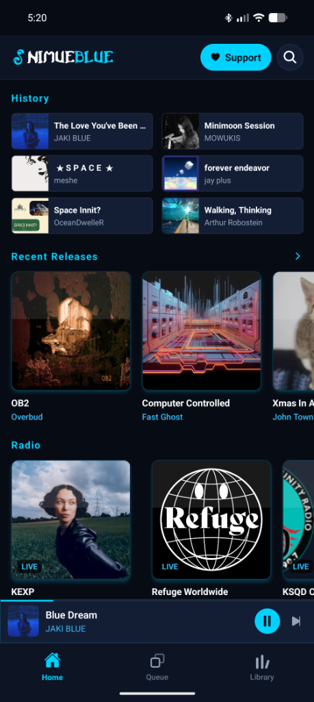

# NimueBlue

An independent audio player for Mirlo, Faircamp catalogs, community radio, podcasts, and your own files.



## Features

- **Independent Music:** Streams releases from [Mirlo](https://mirlo.space) and verified self-hosted [Faircamp](https://simonrepp.com/faircamp/) catalogs discovered through the [Fairplayer hub](https://fairplayer.band/hub/).
- **Global Community Radio:** Live broadcasts from curated independent stations and [Radio-Browser](https://www.radio-browser.info/), spanning community, freeform, pirate, and world music radio.
- **Podcasts & Discussions:** Curated independent shows and federated discovery from the [Castopod Index](https://index.castopod.org/), played directly from publisher RSS enclosures.
- **Direct Artist & Station Support:** Support and Donate actions link straight to the artist's release page (on Mirlo or their own Faircamp site) or the station's donation page.
- **Offline & Local Library:** Downloads saved as standard tagged audio files, local file import, device-side likes and wishlist support for federated catalogs, and a unified queue.
- **No Ads or Tracking:** Open-source client with direct streaming from original hosts.

## How Audio Is Sourced

NimueBlue does not re-host audio. Every track, broadcast, and episode streams directly from the artist's, station's, or publisher's own server.

### 1. Music (Mirlo & Faircamp)

- **Mirlo API & Canimus Chorus Feed:** NimueBlue queries Mirlo's catalog endpoints (`/v1/trackGroups`, `/v1/artists`, `/v1/search`) and its open Canimus Chorus feed (`/v1/sm/canimus.json`). Tracks stream from Mirlo's audio endpoints, and **Support** links open the release page on `mirlo.space` so listeners can buy music and support artists directly.
- **Verified Faircamp Catalogs via Fairplayer:** NimueBlue discovers independent Faircamp sites registered on the [Fairplayer hub](https://fairplayer.band/hub/), which implements Fairplayer's [catalog data-sharing protocol](https://interop.fairplayer.org/specs/catalog/data-sharing-protocol.html). Before surfacing a Faircamp release in discovery or search, the worker verifies that its domain is an active, verified Faircamp catalog on the hub with valid HTTPS audio streams and cover art. Audio plays directly from the artist's Faircamp domain, **Support** links open the artist's own release page, and likes and wishlist entries are stored locally on the device.

### 2. Live Radio

- **Curated Independent Stations:** Includes listener-supported and community stations with live streams and now-playing feeds: KEXP (Seattle), Carbon Sound (Minneapolis), WFMU (Jersey City), Radio alHara (Bethlehem), Dublin Digital Radio (Dublin), Resonance FM (London), Refuge Worldwide (Berlin), Bangkok Community Radio (Bangkok), and 广东音乐之声 (Guangzhou, China).
- **Radio-Browser Discovery & Search:** Queries the open [Radio-Browser](https://www.radio-browser.info/) directory across community, pirate, free radio, DIY, underground, Thai, Chinese, and world music tags, with multi-language and regional search expansions (including Thai, Mandarin, Cantonese, Japanese, Korean, Vietnamese, Indonesian, and Tagalog).
- **Stream Verification:** Discovered stations are filtered for active `https://` direct audio streams (excluding raw `.m3u`/`.pls`/`.asx` playlist files), passing SSL and health checks (`lastcheckok = 1`, `ssl_error = 0`), and high-resolution artwork. In the queue, radio stations play as 10-minute live sets before advancing to the next track.

### 3. Podcasts & Discussions

- **Curated Feeds & Castopod Index:** Combines curated independent shows (such as *Upstream*, *Working Class History*, *Everything Co-op*, *Native Roots Radio*, *Labor History Today*, *Millennials Are Killing Capitalism*, *Srsly Wrong*, *Colonial Outcasts*, and *Black Autonomy*) with federated podcasts discovered through the [Castopod Index](https://index.castopod.org/).
- **Direct RSS Enclosures:** NimueBlue parses each show's standard RSS feed and streams episode audio directly from the publisher's `<enclosure>` URL.

### 4. Downloads & Local Files

- Tracks downloaded in the app are written with embedded metadata and artwork tags (`ID3v2`, `MP4`, `FLAC`, or `Ogg`) and matched seamlessly with online releases. Listeners can also import their own audio files from device storage for offline playback.

## Quick Start

**Requirements:** Node.js 20 or later

```bash
npm install
```

Create `.env`:
```env
EXPO_PUBLIC_API_ROOT=https://mirlo.space
EXPO_PUBLIC_API_KEY=
```

Start the web development server:
```bash
npm run web
```
Open `http://localhost:8081`.

Fairplayer discovery, web RSS feed proxying, and share preview pages use the Cloudflare Worker in `worker/`. The default worker URL is configured in `queries/shareHub.ts`. For local worker development:

```bash
npx wrangler dev --config worker/wrangler.toml --local --port 8787
```

Set `EXPO_PUBLIC_SHARE_HUB_URL=http://127.0.0.1:8787` in `.env.local` before starting Expo to route requests through your local worker.

## Building for Android

**Download:** Grab the latest APK from [Releases](https://github.com/grendel116/nimueblue/releases).

To build the Android release APK locally from source:
```bash
node scripts/buildWebShell.js
cd android && ./gradlew assembleRelease
```
The signed release APK is output to `android/app/build/outputs/apk/release/app-release.apk`.

## Tests

```bash
npm test
```

## Credits & License

Originally forked from the [Mirlo mobile app](https://github.com/funmusicplace/mirlo-mobile). Support artists at [mirlo.space](https://mirlo.space) and across independent [Faircamp](https://fairplayer.band/hub/) catalogs.

Released under the **GNU AGPL v3.0** license. See [LICENSE](LICENSE) and [License.md](License.md).
